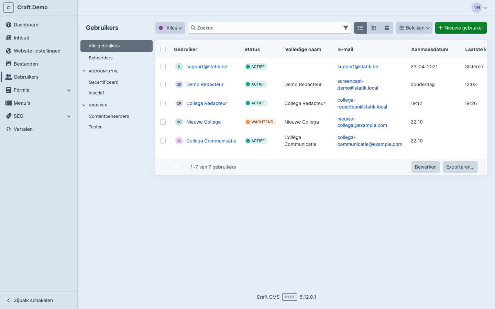
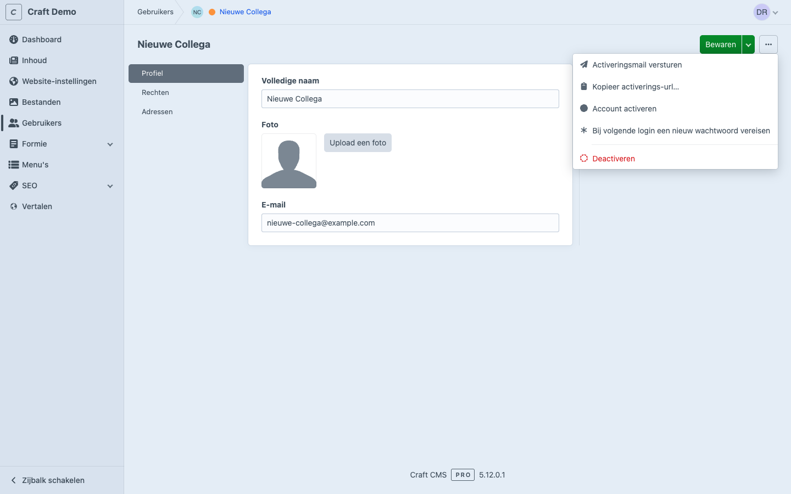

# Een account beheren

Na het aanmaken van een account (zie *Een collega toegang geven*) moet je soms nog iets regelen: een activatiemail die niet aankomt, een gewijzigd e-mailadres, een collega die vertrekt. Dat doe je allemaal zelf onder **Gebruikers**.

## De status van een account

In de lijst **Gebruikers** zie je per account een status:

- **Actief**: de persoon kan inloggen.
- **Wachtend**: het account bestaat, maar de persoon heeft nog geen wachtwoord gekozen via de activatiemail.
- **Inactief**: het account is gedeactiveerd en kan niet meer inloggen.

<!-- screenshot: Gebruikers, lijst met een wachtend en een actief demo-account; markeer de statussen -->

## De activatiemail opnieuw sturen

1. Open het account met status **Wachtend**.
2. Open het actiemenu en kies **Activeringsmail versturen**.

Komt de mail niet aan (spamfilter, tikfout in het adres), kopieer dan de link:

1. Kies in het actiemenu **Kopieer activerings-url…**.
2. Plak de link in een bericht aan je collega, via een kanaal dat je vertrouwt.

De link is drie weken geldig. Daarna stuur je een nieuwe.

<!-- screenshot: account Nieuwe Collega (wachtend) open, actiemenu met Activeringsmail versturen en Kopieer activerings-url… -->

> **Tip:** controleer eerst of het e-mailadres juist gespeld is. Dat is de meest voorkomende reden waarom een mail niet aankomt.

## Een e-mailadres wijzigen

Krijgt een collega een nieuw adres (een andere naam, een freelancer die nu met een eigen adres werkt), open dan het account, pas het **E-mail**adres aan en klik op **Bewaren**. Je hoeft geen nieuw account te maken: alle pagina's blijven aan dezelfde persoon gekoppeld. Het nieuwe adres is vanaf dan ook de login.

## Iemand vertrekt: deactiveren

1. Open het account.
2. Kies in het actiemenu **Deactiveren** en bevestig.

De status wordt **Inactief**. De persoon kan niet meer inloggen, maar blijft de auteur van wat hij of zij maakte. Komt de persoon terug, dan activeer je het account opnieuw.

## Waarom niet verwijderen?

Een account verwijderen kan je als contentbeheerder niet zelf, en dat heeft een reden. Pagina's en berichten hangen aan hun auteur. Wie een account verwijdert, moet kiezen of de inhoud overgaat naar iemand anders (**Overdragen naar:**). Gebeurt dat niet, dan verdwijnt die inhoud mee. Deactiveren is dus bijna altijd de betere keuze.

> **Let op:** moet een account toch echt weg, vraag het ons. Wij dragen de inhoud dan eerst over aan een collega die blijft.

## Veelgestelde vragen

- **Mijn collega vindt de activatiemail niet.** Laat in de spammap kijken, of kopieer de activatielink en stuur hem zelf door.
- **Kan ik iemands wachtwoord instellen?** Nee, en dat is een goede zaak. Je kan wel een mail sturen om het wachtwoord opnieuw in te stellen, via het actiemenu.
- **Moet ik een nieuw account maken voor een nieuw e-mailadres?** Nee, pas het adres aan in het bestaande account.

## Zie ook

- Een collega toegang geven
- Met meerdere mensen aan de site werken
