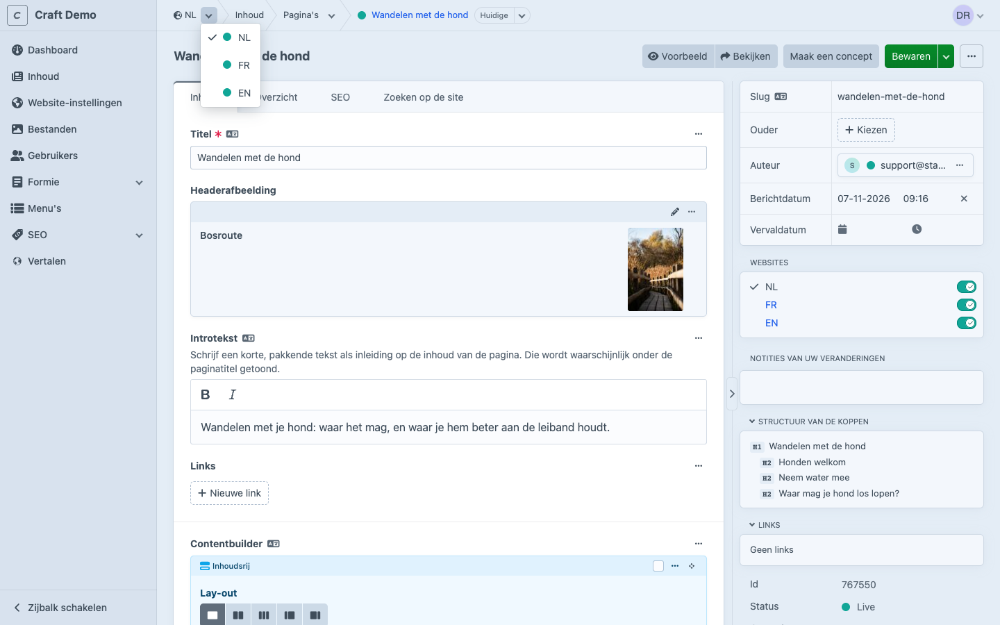
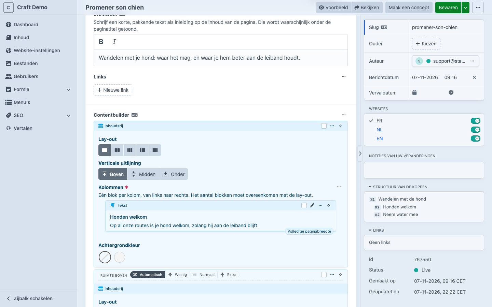

# Een pagina vertalen

Je site bestaat in het Nederlands (**NL**), het Frans (**FR**) en het Engels (**EN**). Een pagina is één pagina met een versie per taal: ze zijn aan elkaar gekoppeld, zodat de taalknop op de site een bezoeker naar dezelfde pagina in een andere taal brengt. Hier lees je hoe je vertaalt, wat er bij een nieuwe pagina vanzelf gebeurt en wat je doet met inhoud die maar in één taal bestaat.

## Nooit een nieuwe pagina voor een andere taal

> **Let op:** maak voor de Franse of Engelse versie **geen nieuwe pagina** aan. Een nieuwe pagina is niet gekoppeld aan de Nederlandse. De taalknop werkt dan niet, en je hebt twee pagina's die in alle drie de talen bestaan.

Open altijd de bestaande pagina en wissel van taal.

## Van taal wisselen

1. Open de pagina.
2. Klik linksboven op de taalkeuze (**NL**) en kies **FR** of **EN**.
3. De pagina laadt opnieuw in die taal.

<!-- screenshot: pagina geopend, taalkeuze opengeklapt met NL, FR en EN -->

## Wat gebeurt er bij een nieuwe pagina?

Maak je een pagina aan in het Nederlands en bewaar je ze voor het eerst, dan:

- **kopieert** de site alle inhoud naar het Frans en het Engels (titel, intro, afbeeldingen, rijen);
- staat de pagina in **alle talen ingeschakeld**, dus online, met de Nederlandse tekst.

Daarna kopieert de site niets meer: wat je in het Nederlands verandert, blijft in het Nederlands. Anders zou elke wijziging je vertaling overschrijven.

> **Let op:** vertaal je niet meteen, zet de pagina in die taal dan uit. Anders staat er op de Franse site een Nederlandse pagina.

Nieuwsberichten en activiteiten staan standaard in alle talen uit; die zet je per taal aan als ze klaar zijn.

## Vertalen

In de andere taal vertaal je:

- de **titel** en de **slug** (het adres: "promener-son-chien" in plaats van "wandelen-met-de-hond");
- de **Introtekst** en de **Headerafbeelding** als je een ander beeld wil;
- de rijen van de **Contentbuilder**;
- de tabs **Overzicht** en **SEO**.

Elke taal heeft haar eigen inhoud. Je mag in het Frans een rij weglaten, een rij toevoegen of de volgorde veranderen. De Nederlandse versie blijft zoals ze is.

<!-- screenshot: pagina op FR, titel en slug vertaald, een rij nog in het Nederlands -->

## Status per taal

De status geldt per taal: in de zijbalk staat onder **Websites** een schakelaar per taal (**NL**, **FR**, **EN**). Zet je er een uit en klik je op **Bewaren**, dan verdwijnt de pagina van die taalversie van de site. Zo kan je:

- een pagina in het Frans uitzetten tot de vertaling klaar is;
- een pagina die enkel voor Nederlandstaligen bedoeld is, in het Frans en het Engels helemaal uit laten.

Een pagina die in een taal uit staat, verschijnt daar niet: niet in menu's, niet in overzichten en niet in de zoekresultaten.

## Werk met een concept

Voor een grotere vertaling of herwerking maak je best een concept (zie *Werken met een concept*). Zo staat de oude versie online tot je klaar bent. Weet ook dat een revisie terugzetten (zie *Iets ongedaan maken: revisies en de prullenbak*) de hele pagina terugzet, en dus ook wat je intussen in de andere talen veranderde.

## Niet enkel pagina's

Hetzelfde principe geldt overal: wissel bovenaan van taal.

- **Categorieën**: vertaal de titel per taal (zie *Categorieën beheren*).
- **Menu's**: elke taal heeft haar eigen menu's (zie *De menu's aanpassen*).
- **Vaste teksten**: in **Vertalen** (zie *Vaste teksten aanpassen*). Zie je Nederlands op de Franse site dat in geen enkele pagina staat, dan staat het daar.
- **Website-instellingen**: adres en sociale media per taal (zie *Algemene inhoud op één plek*).

## Veelgestelde vragen

- **Moeten we voor Franse inhoud een nieuwe pagina maken?** Nee, open de bestaande pagina en wissel naar FR.
- **En als de inhoud in het Frans echt helemaal anders is?** Dan pas je de Franse versie vrij aan, of zet je de pagina in het Frans uit en maak je een aparte pagina die je in het Nederlands uitzet.
- **Vind je met de zoekfunctie ook pagina's uit een andere taal?** De zoekfunctie zoekt in de taal van de site waarop je zoekt.
- **Kan ik alles meteen in alle talen doen?** De site kopieert bij de eerste keer bewaren alles naar de andere talen. Wat je later toevoegt, kopieer je zelf (zie *Nieuwe inhoud naar de andere taal kopiëren*).

## Zie ook

- Nieuwe inhoud naar de andere taal kopiëren
- Werken met een concept
- Vaste teksten aanpassen
