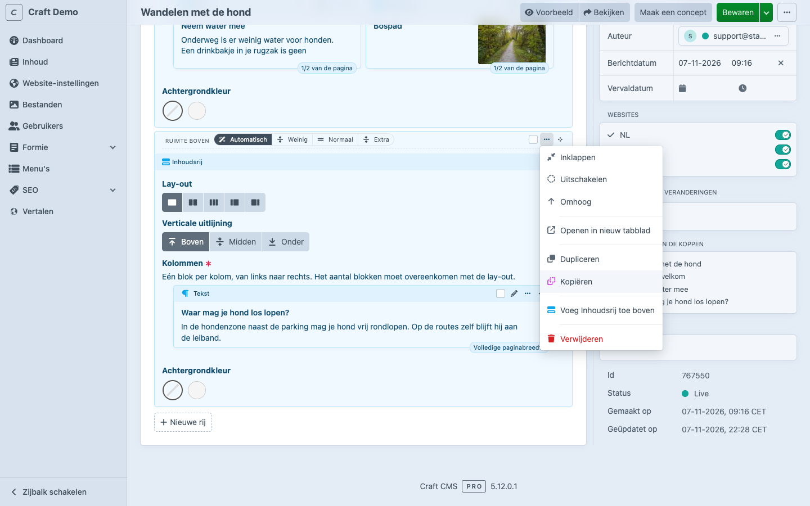
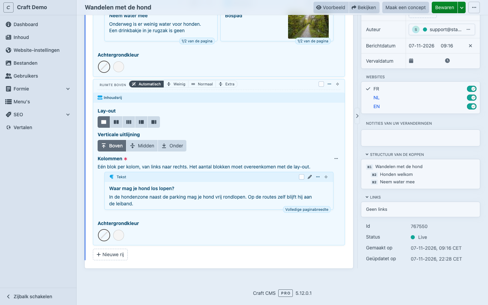

# Nieuwe inhoud naar de andere taal kopiëren

Bij de eerste keer bewaren kopieert de site een nieuwe pagina naar alle talen (zie *Een pagina vertalen*). Wat je daarna in het Nederlands toevoegt, blijft in het Nederlands. Zo kan je elke taal vrij bewerken zonder dat de ene de andere overschrijft. Maar het betekent ook dat je een nieuwe rij zelf naar de andere taal brengt. Dat doe je met kopiëren en plakken.

## Eén rij kopiëren

1. Open de pagina in de taal waar de rij al staat, bijvoorbeeld **NL**.
2. Open het actiemenu van de rij en kies **Kopiëren**. Er verschijnt kort een melding.
3. Wissel linksboven naar de andere taal, bijvoorbeeld **FR**.
4. Klik onderaan de **Contentbuilder** op **Invoer plakken**, naast **Nieuwe rij**: de rij komt onderaan. Moet ze ergens anders komen, open dan het actiemenu van de rij waarboven ze moet staan en kies **block hierboven plakken**.
5. Vertaal de geplakte rij.
6. Klik op **Bewaren**.

<!-- screenshot: pagina op NL, actiemenu van een rij open, Kopiëren gemarkeerd -->

<!-- screenshot: pagina op FR, de geplakte rij onderaan nog met Nederlandse tekst -->

## Alle rijen kopiëren

Is er veel veranderd, dan kopieer je alles in één keer: open het actiemenu bovenaan de **Contentbuilder** en kies **Alle blokken kopiëren**. Plak in de andere taal, en verwijder daarna de rijen die nu dubbel staan.

> **Tip:** alles kopiëren is handig als de Franse pagina nog leeg of sterk verouderd is. Is de Franse pagina al grotendeels vertaald, kopieer dan enkel de nieuwe rijen. Zo hoef je niets dubbel op te ruimen.

## Wat gaat er mee?

Een rij gaat mee met haar lay-out, instellingen (achtergrond, uitlijning, ruimte erboven) en alle kolommen: teksten, afbeeldingen, links. Afbeeldingen zijn dezelfde bestanden; vul de alternatieve tekst bij de afbeelding ook in de andere taal in (zie *Alt-tekst, bijschrift en copyright*).

## Automatisch vertalen

Op sommige sites staat een extra knop om een volledige pagina automatisch te laten vertalen, bijvoorbeeld met DeepL. Dat werkt per pagina, alles of niets: opnieuw vertalen overschrijft je eigen correcties. Kijk het resultaat altijd na, liefst in een concept. Interesse in zo'n koppeling? Laat het ons weten.

## Veelgestelde vragen

- **Kunnen we alles meteen in alle talen doen?** Bij een nieuwe pagina gebeurt dat bij de eerste keer bewaren. Wat je later toevoegt, kopieer je zoals hierboven.
- **Overschrijft plakken mijn vertaalde rijen?** Nee, een geplakte rij komt erbij. De bestaande rijen blijven staan.
- **Kan ik een rij ook naar een andere pagina kopiëren?** Ja, op dezelfde manier (zie *Kopiëren naar een andere pagina*).

## Zie ook

- Een pagina vertalen
- Werken met een concept
