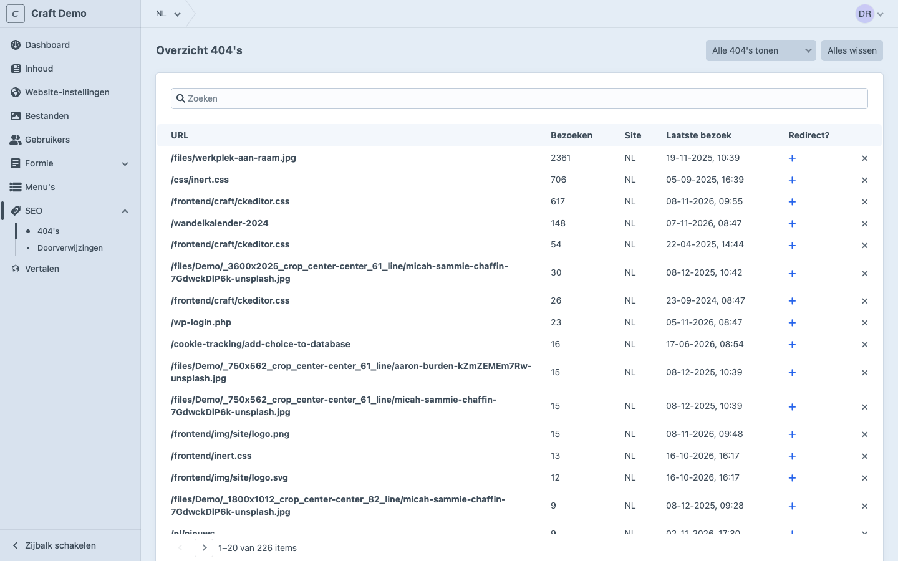
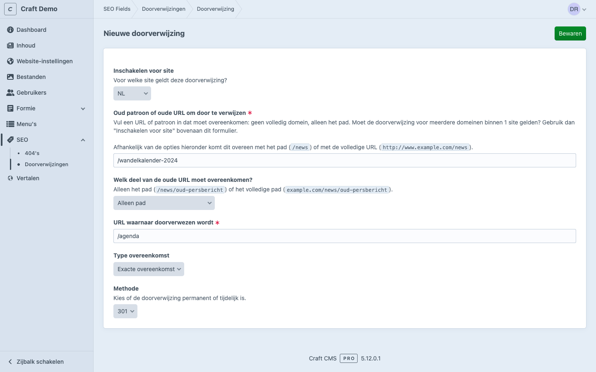

# 404's opvolgen en redirects maken

Een **404** is een adres op je site dat niet bestaat: de bezoeker krijgt de pagina niet gevonden. Dat gebeurt via oude links op andere sites, bladwijzers, links in mails of brochures, of tikfouten. Een **redirect** stuurt zo'n adres automatisch door naar een pagina die wel bestaat. Hier lees je hoe je de 404's opvolgt en redirects maakt.

## De lijst met 404's

Klik in de zijbalk op **SEO** en dan op **404's**. Je ziet elk adres dat bezoekers probeerden en dat niet bestond:

- **URL**: het adres;
- **Bezoeken**: hoe vaak iemand het probeerde;
- **Site**: in welke taal;
- **Laatste bezoek**: wanneer het laatst;
- **Redirect?**: een plusje om meteen een redirect te maken.

Met de keuzelijst bovenaan toon je alle 404's, enkel de adressen zonder redirect (**Zonder doorverwijzing**) of enkel die met een redirect.

<!-- screenshot: SEO, 404's, demo-adressen met bezoeken; markeer de kolom Redirect? en de keuzelijst bovenaan -->

Bij de lancering maken we de lijst leeg: in de testfase staat ze vol testadressen. Vanaf dan zie je enkel echte bezoeken.

## Wat volg je op?

- **Veel bezoeken**: hier zoeken echte mensen iets. Bijvoorbeeld een pagina van je vorige site waar een andere site nog naar linkt.
- **Vreemde adressen** zoals `/wp-login.php`, `/admin` of lange reeksen tekens zijn bots die naar zwakke plekken zoeken. Negeer ze; er is niets aan te doen en het kan geen kwaad.
- **Een tikfout** in een adres dat je zelf verspreidde: maak er een redirect voor.

> **Tip:** spreek af dat één persoon de 404's geregeld bekijkt, bijvoorbeeld maandelijks, en vaker in de eerste weken na de lancering.

## Een redirect maken vanuit de 404-lijst

1. Klik op het plusje in de kolom **Redirect?**.
2. Het oude adres is al ingevuld bij **Oud patroon of oude URL om door te verwijzen**.
3. Vul bij **URL waarnaar doorverwezen wordt** het adres in van de pagina die het best past bij wat de bezoeker zocht. Vul het pad in zonder de taal ervoor: `/agenda` brengt je op de Nederlandse site naar `/nl/agenda`. Geen exacte vervanger? Kies het overzicht of de bovenliggende pagina, en als het echt niet anders kan de homepage.
4. Laat **Methode** op **301** staan: dat is een permanente redirect. Zo weten ook zoekmachines dat de pagina verhuisd is. (**302** is tijdelijk.)
5. Bewaar.
6. Test het oude adres op de site.

<!-- screenshot: Nieuwe doorverwijzing, oude URL ingevuld, URL waarnaar doorverwezen wordt "/agenda", Methode 301 -->

## Automatische redirects

Pas je de slug van een pagina aan, of verplaats je een pagina in de structuur, dan maakt de site zelf een redirect van het oude naar het nieuwe adres (zie *De slug aanpassen*). Je ziet ze in **SEO** → **Doorverwijzingen**, met hoe vaak ze gebruikt worden (**Bezoeken**).

## Zelf een redirect maken

Klik in **Doorverwijzingen** op **Nieuwe doorverwijzing**. Typische gevallen:

- een **kort adres** voor een actie of een flyer: `/zomer` naar een pagina drie niveaus diep;
- een **foute link in een verstuurde mail of gedrukte brochure**: de mail pas je niet meer aan, de redirect wel;
- een pagina van je **vorige site** die nog veel bezocht wordt.

Vul enkel het pad in (`/zomer`), niet het volledige domein. Kies bij **Inschakelen voor site** voor welke taal de redirect geldt, of **Alle sites**.

## Redirects niet verwijderen

> **Let op:** verwijder na de lancering geen redirects, ook niet als ze oud lijken. Bladwijzers, oude mails en zoekmachines gebruiken ze soms nog jaren. Een redirect kost niets.

## Gebroken links in je eigen inhoud

De 404-lijst toont wat bezoekers tevergeefs proberen. Voor kapotte links **in je eigen pagina's** is er de widget **Kapotte links** op het dashboard, en het paneel met links in de zijbalk van elke pagina (zie *Gebroken links opsporen*). Zo los je het probleem op bij de bron.

## Veelgestelde vragen

- **Moet ik elke 404 doorsturen?** Nee, enkel die van echte bezoekers. Bots negeer je.
- **Wat als de oude pagina geen opvolger heeft?** Stuur door naar de pagina die er het dichtst bij komt, of laat de 404 staan: een goede pagina niet gevonden (zie *De vaste pagina's*) helpt de bezoeker ook verder.
- **Ik heb een slug aangepast. Moet ik zelf een redirect maken?** Nee, dat doet de site. Kijk het eventueel na bij **SEO** > **Doorverwijzingen**.

## Zie ook

- De slug aanpassen
- Gebroken links opsporen
- De vaste pagina's
