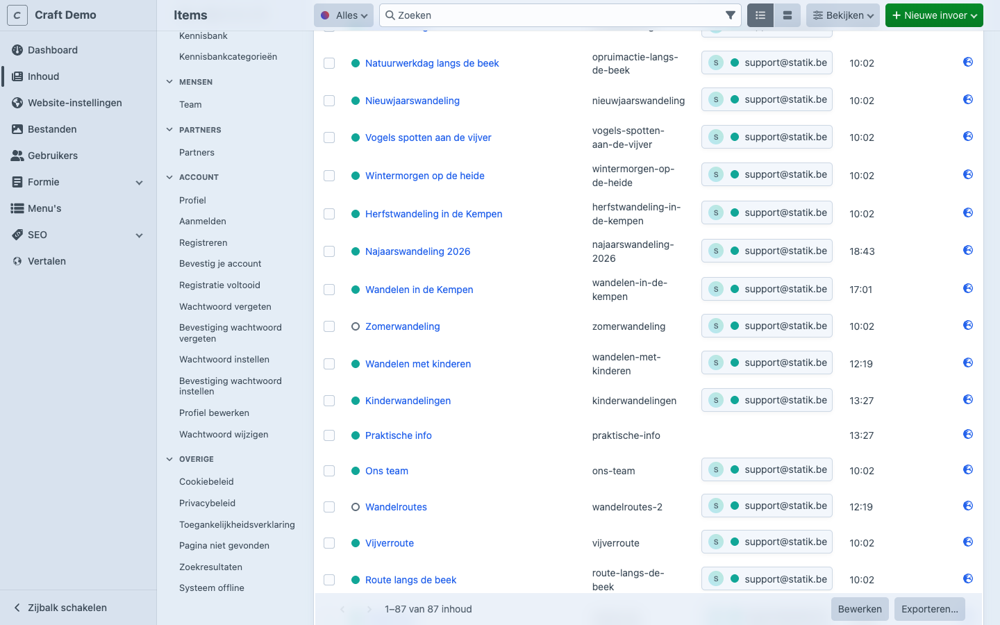
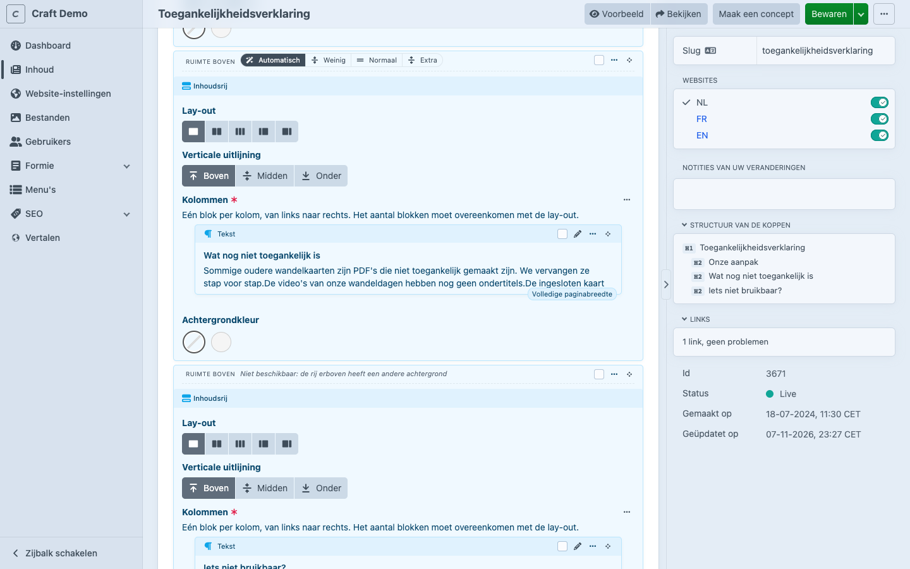

# De verplichte pagina's

Drie pagina's moet elke site hebben: een **cookiebeleid**, een **privacybeleid** en een **toegankelijkheidsverklaring**. Ze staan klaar op je site. Je vult ze één keer goed in en houdt ze daarna up-to-date. Hier lees je waar ze staan en wat erin hoort. Dit is geen juridisch advies: twijfel je over de inhoud, vraag het dan aan wie bij jullie de privacy opvolgt.

## Waar staan ze?

Ga naar **Inhoud** en scroll in de linkerkolom naar de kop **Overige**. Daar staan **Cookiebeleid**, **Privacybeleid** en **Toegankelijkheidsverklaring**. Het zijn vaste pagina's: je kan ze niet verwijderen.

De site zet de links naar deze drie pagina's zelf onderaan in de footer, samen met een knop om de cookie-instellingen opnieuw te openen. Je hoeft ze dus niet in een menu te zetten.

<!-- screenshot: Inhoud, kop Overige met Cookiebeleid, Privacybeleid en Toegankelijkheidsverklaring gemarkeerd -->

Het zijn gewone pagina's met een **Contentbuilder**: je werkt met tekstkolommen, tussentitels en eventueel een tabelkolom, zoals elders. Op een meertalige site vertaal je ze in elke taal (zie *Een pagina vertalen*).

## Cookiebeleid

Leg uit welke cookies de site gebruikt, waarvoor, en hoe bezoekers hun keuze aanpassen.

- Wij bezorgen een voorbeeldtekst waarin je vooral jullie gegevens aanpast.
- De **tabel met de cookies** die de site echt gebruikt (bijvoorbeeld voor statistieken) vullen wij in bij de lancering, als alle diensten gekoppeld zijn.
- Komt er later een nieuwe dienst bij (een nieuwe marketingtool, een ingebedde kaart), laat het ons weten: dan kijken we de cookiebanner en de tabel na.

## Privacybeleid

Zodra je gegevens van bezoekers verzamelt, leg je uit wat je ermee doet. Denk aan:

- welke gegevens je vraagt, bijvoorbeeld via formulieren;
- waarvoor je ze gebruikt en wie ze te zien krijgt;
- hoe lang je ze bewaart. De site verwijdert formulierinzendingen na één jaar automatisch (zie *Inzendingen bekijken, exporteren en spam*);
- hoe mensen hun gegevens kunnen opvragen of laten verwijderen.

Ook hiervoor bezorgen we een voorbeeld.

## Toegankelijkheidsverklaring

Sinds de zomer van 2025 geldt de **Europese toegankelijkheidswet** (European Accessibility Act). Een toegankelijkheidsverklaring hoort daarbij. Wij bouwen de site zo toegankelijk mogelijk, maar wat er later bijkomt, ligt bij jullie. In de verklaring staat:

- hoe toegankelijk de site is en volgens welke norm;
- wat **niet** toegankelijk is. Vaak zijn dat documenten: een PDF die niemand toegankelijk opmaakte, een gescande brochure, een video zonder ondertitels;
- een **contactmogelijkheid**: minstens een e-mailadres, liefst ook een telefoonnummer, waar iemand een probleem kan melden of de informatie in een andere vorm kan vragen.

> **Tip:** de contactmogelijkheid is het belangrijkste stuk. Een blinde bezoeker die een PDF niet kan lezen, moet weten waar die de inhoud op een andere manier kan krijgen.

De overheid biedt een hulpmiddel dat je stap voor stap door zo'n verklaring loodst; je kopieert het resultaat daarna in de pagina. Vraag ons gerust de link.

<!-- screenshot: Toegankelijkheidsverklaring geopend, rijen met gekende problemen en contactgegevens gemarkeerd -->

## Bijhouden

Lees de drie pagina's minstens jaarlijks na, en telkens als er iets verandert: een nieuw formulier, een nieuwe dienst, een nieuw soort documenten.

## Veelgestelde vragen

- **Moeten we dat allemaal zelf schrijven?** Nee, je vertrekt van onze voorbeeldteksten en past ze aan jullie organisatie aan.
- **Mogen we PDF's gebruiken als ze niet toegankelijk zijn?** Ja, maar vermeld ze in de verklaring en bied de inhoud op aanvraag in een andere vorm aan. Beter nog: zet de belangrijkste inhoud gewoon op een pagina.
- **Wie vult de cookietabel in?** Wij, bij de lancering.

## Zie ook

- De vaste pagina's
- Inzendingen bekijken, exporteren en spam
- Een PDF of ander bestand aanbieden
